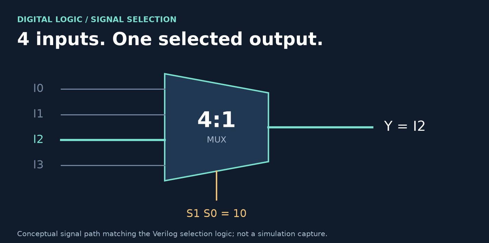

<div align="center">

**DIGITAL LOGIC · VERILOG · LOGISIM**

# Four Paths. One Output.

### Scale the selection idea from two inputs to four.

[Explore the project](#project-overview) · [Documentation](#project-documentation) · [Contact the developer](mailto:louise.catala24@gmail.com)

</div>

<p align="center">
  
</p>

<p align="center"><em>Explanatory diagram derived from the Verilog selection logic; not a captured simulation.</em></p>

## Project overview

Two select bits choose one of four data inputs. This project pairs a Verilog implementation with a Logisim gate circuit so you can follow the selection rule from a truth table to an actual implementation file.

| At a glance | What it means |
| --- | --- |
| **4 inputs** | I0 through I3 |
| **2 selectors** | S1 and S0 encode the selection |
| **4 test cases** | The supplied testbench sequence |

## A small circuit with a useful idea

Selection codes `00`, `01`, `10`, and `11` route `I0`, `I1`, `I2`, and `I3` respectively. The included testbench uses four fixed-data cases; it does not cover all 64 binary input combinations. The preserved validation notes below distinguish the file checks from simulations that have not been run.

[Read the Verilog module](4to1mux.v) · [Open the testbench](4to1mux_tb.v) · [Explore the Logisim circuit](4to1mux.circ)

## Project documentation

<details>
<summary><strong>Open the original project notes, files, and setup instructions</strong></summary>

# 4-to-1 Multiplexer

A 4-to-1 multiplexer implemented in Verilog and Logisim, based on the supplied lab PDF.

## Files

- `4to1mux.v`: Verilog module `mux4to1`.
- `4to1mux_tb.v`: Testbench `mux4to1_tb` with the PDF's four test cases.
- `4to1mux.circ`: Logisim circuit with two NOT gates, four three-input AND gates, and one four-input OR gate. Matching tunnel labels connect signals without long wires.

## Operation

The select inputs choose which data input passes to `Y`:

| S1 | S0 | Y |
| --- | --- | --- |
| 0 | 0 | I0 |
| 0 | 1 | I1 |
| 1 | 0 | I2 |
| 1 | 1 | I3 |

Boolean expression (`~` means NOT, `&` means AND, `|` means OR):

```text
Y = (I0 & ~S1 & ~S0) | (I1 & ~S1 & S0)
  | (I2 & S1 & ~S0) | (I3 & S1 & S0)
```

## Requirements

- Icarus Verilog for compiling and running the Verilog simulation.
- GTKWave for viewing waveforms.
- Logisim 2.7.1 or a compatible version for opening the circuit.

## Run the Verilog Simulation

Extract the ZIP, then open a terminal in the extracted folder containing the files.

```bash
iverilog -s mux4to1_tb -o mux4to1.vvp 4to1mux.v 4to1mux_tb.v
vvp mux4to1.vvp
```

The simulation prints the results and creates `mux4to1.vcd` in the current folder.

To view the waveform:

```bash
gtkwave mux4to1.vcd
```

Add `I0`, `I1`, `I2`, `I3`, `S1`, `S0`, and `Y` to the waveform display.

## Expected Testbench Results

The testbench holds `I0=0`, `I1=1`, `I2=0`, and `I3=1`, changing the select inputs every 10 ns.

| I0 | I1 | I2 | I3 | S1 | S0 | Y |
| --- | --- | --- | --- | --- | --- | --- |
| 0 | 1 | 0 | 1 | 0 | 0 | 0 |
| 0 | 1 | 0 | 1 | 0 | 1 | 1 |
| 0 | 1 | 0 | 1 | 1 | 0 | 0 |
| 0 | 1 | 0 | 1 | 1 | 1 | 1 |

These four cases match the PDF; they do not exhaust all 64 binary input combinations.

## Open the Logisim Circuit

1. Open Logisim.
2. Select File > Open and choose `4to1mux.circ`.
3. Use the Poke Tool to toggle the data and select input pins.
4. Observe `Y` and compare it with the selection table above.

## Validation Status

The circuit file is well-formed XML. The Verilog simulation and Logisim circuit have not been run in the creation environment.


</details>

---

## License and Support

Copyright © 2026 Orland Louise Catala. All rights reserved for my original work, except where an existing license states otherwise. Third-party materials remain subject to their respective licenses.

Please do not copy, modify, redistribute, sell, or claim my original project files as your own without my permission.

I’m a student developer with limited financial resources, and these projects represent many hours of effort. Please respect and support my work. If you would like a copy of the project files, contact me at **[louise.catala24@gmail.com](mailto:louise.catala24@gmail.com)** to discuss a cheap price. Your support helps me continue studying and creating.
